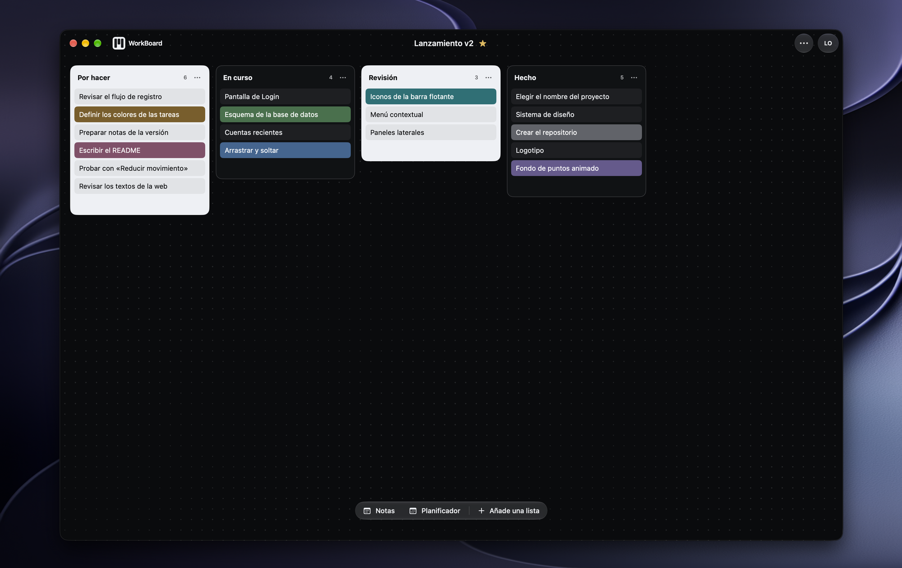
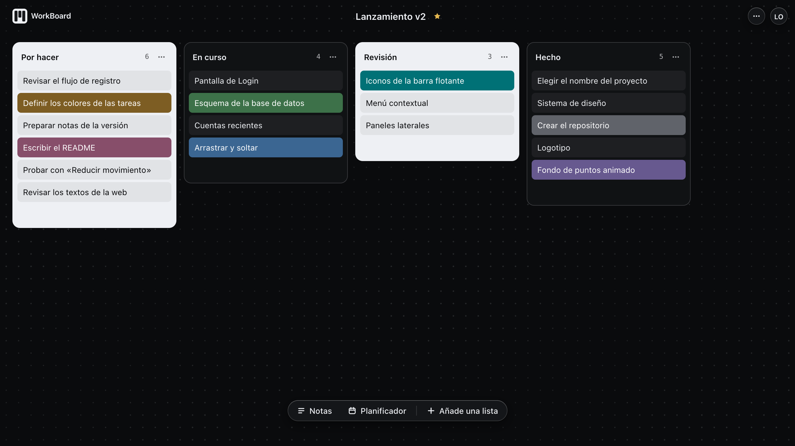
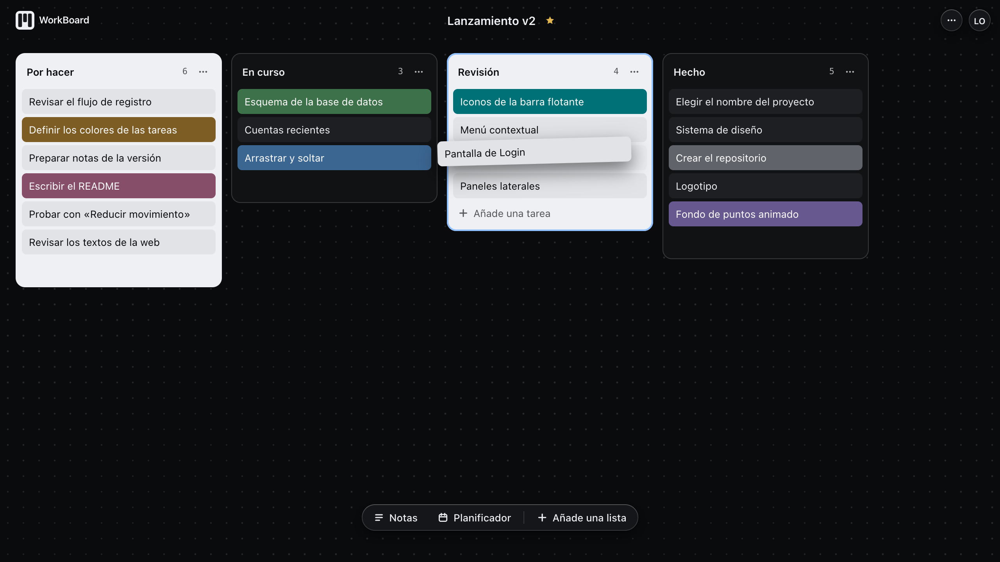
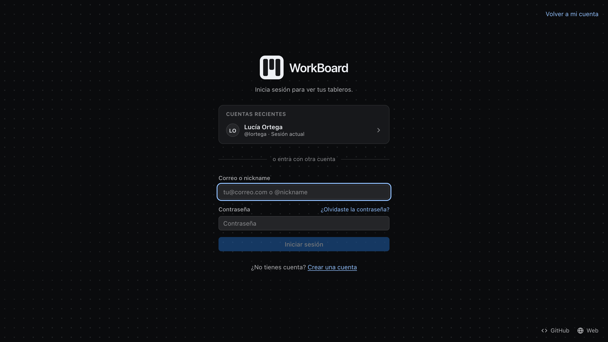

<div align="center">
  <picture>
    <source media="(prefers-color-scheme: dark)" srcset="brand/logo/workboard-simbolo-oscuro.svg" />
    
  </picture>
  <h1>WorkBoard</h1>
  <p>Organiza cada proyecto en <b>tableros</b>, <b>listas</b> y <b>tareas</b>.<br />Una app nativa para Mac que también funciona en el navegador, con la misma cuenta.</p>
  <p>
    <a href="https://getworkboard.netlify.app"><b>Abrir la web</b></a>
    &nbsp;·&nbsp;
    <a href="https://getworkboard.netlify.app/descargas/WorkBoard.dmg"><b>Descargar para Mac</b></a>
  </p>
</div>

<p align="center">
  
</p>

## Características

- **Tableros**: con descripción opcional y un fondo de color o una cuadrícula de puntos animada que reacciona al cursor. Marca con ⭐ los que más usas para que aparezcan primero, y búscalos por nombre aunque no escribas las tildes.
- **Listas y tareas**: listas blancas o negras, ordenadas en horizontal; tareas con nombre, descripción y uno de los diez colores.
- **Arrastrar y soltar**: lleva tareas de una lista a otra y reordena las listas. En la web también con el teclado.
- **Deshacer y rehacer** (⌘Z / ⇧⌘Z) cualquier cambio, incluidos los borrados: un tablero vuelve con todas sus listas y tareas.
- **Borrado seguro**: cualquier eliminación definitiva pide confirmación antes.
- **Cuentas**: entra con tu correo o tu nickname y la sesión se mantiene abierta. Las últimas cuentas del dispositivo se abren sin volver a escribir la contraseña. Puedes recuperar la contraseña por correo y eliminar la cuenta con todos sus datos.
- **Mac y web sincronizados**: tus tableros se guardan en la nube y se abren desde cualquiera de las dos.
- **Próximamente**: Notas y Planificador, como paneles laterales dentro de cada tablero.

<table>
  <tr>
    <td width="50%"></td>
    <td width="50%"></td>
  </tr>
  <tr>
    <td align="center">Mi espacio de trabajo, con los favoritos primero</td>
    <td align="center">Listas blancas o negras y tareas de colores</td>
  </tr>
  <tr>
    <td width="50%"></td>
    <td width="50%"></td>
  </tr>
  <tr>
    <td align="center">Arrastrar y soltar tareas y listas</td>
    <td align="center">La web, con las cuentas recientes</td>
  </tr>
</table>

## Plataformas

| Plataforma | Estado | Requisitos |
| --- | --- | --- |
| macOS | ✅ Disponible: [descargar](https://getworkboard.netlify.app/descargas/WorkBoard.dmg) | macOS 27.2 o posterior, Mac con Apple Silicon |
| Web | ✅ Disponible: [getworkboard.netlify.app](https://getworkboard.netlify.app) | Un navegador actual |

### Instalar en el Mac

1. Descarga [WorkBoard.dmg](https://getworkboard.netlify.app/descargas/WorkBoard.dmg), ábrelo y arrastra WorkBoard a **Aplicaciones**.
2. La app no está notarizada por Apple, así que la primera vez macOS no la abrirá. Ve a **Ajustes del Sistema → Privacidad y seguridad**, baja hasta el aviso de WorkBoard y pulsa **Abrir igualmente**.

## Stack tecnológico

| Capa | Tecnología |
| --- | --- |
| App macOS | Swift · SwiftUI · Liquid Glass · [supabase-swift](https://github.com/supabase/supabase-swift) · Swift Testing |
| Web | [Next.js](https://nextjs.org) 16 (App Router) · React 19 · TypeScript · CSS Modules con los tokens del sistema de diseño · `@supabase/ssr` · [dnd-kit](https://dndkit.com) |
| Tests web | [Vitest](https://vitest.dev) (lógica) · [Playwright](https://playwright.dev) y axe (flujos y accesibilidad) |
| Backend | [Supabase](https://supabase.com): PostgreSQL, Auth, Row Level Security y Edge Functions |
| Despliegue | [Netlify](https://www.netlify.com) (web y descarga de la app de Mac) |

## Arquitectura

Monorepo con un único backend compartido por las dos apps:

```
workboard/
├── apps/
│   ├── macOS/      # App nativa (Xcode · SwiftUI) y script del .dmg
│   └── web/        # App web y landing (Next.js)
├── brand/logo/     # Logo en SVG, todas sus variantes y reglas de uso
└── supabase/       # Esquema de la base de datos, migraciones y Edge Functions
```

Las dos apps aplican las mismas reglas (registro, orden de los tableros, posiciones de listas y tareas, deshacer) y hablan con las mismas tablas, protegidas con Row Level Security: cada cuenta solo ve sus datos.

## Desarrollo local

### Requisitos

- macOS 27.2 o superior y Xcode 27 o superior, para la app de Mac.
- [Node.js](https://nodejs.org) 24 y npm, para la web.
- Una cuenta de [Supabase](https://supabase.com) (el plan Free es suficiente).
- [Supabase CLI](https://supabase.com/docs/guides/cli) 3.x: `brew install supabase`.

No hace falta Docker: el backend se despliega directamente en un proyecto de Supabase en la nube.

### 1. Backend (Supabase)

1. Crea un proyecto en el [dashboard de Supabase](https://supabase.com/dashboard).
2. En **Authentication → Sign In / Providers**:
   - Desactiva **Confirm email**.
   - En **Email**, pon **Minimum password length** en 8.
3. En **Authentication → URL Configuration**, añade a **Redirect URLs** las direcciones a las que vuelve el enlace para recuperar la contraseña:
   - `http://localhost:3000/auth/confirm` (web en local).
   - `workboard://reset-password` (app de Mac).
   - La dirección de tu web publicada seguida de `/auth/confirm`, si la despliegas. Pon también esa dirección como **Site URL**.
4. Desde la raíz del repositorio, enlaza la CLI con tu proyecto. Hazlo en una terminal interactiva, porque `supabase link` pide la contraseña de la base de datos:

   ```sh
   supabase login
   supabase link <project-ref>
   ```

5. Aplica las migraciones y despliega las Edge Functions:

   ```sh
   supabase db push --remote
   supabase functions deploy --use-api --remote
   ```

| Pieza | Qué contiene |
| --- | --- |
| `supabase/migrations/` | Esquema (perfiles, tableros, listas y tareas), Row Level Security y funciones de registro |
| `supabase/functions/sign-in` | Inicio de sesión con correo o nickname; el correo de un nickname se resuelve en el servidor |
| `supabase/functions/delete-account` | Elimina la cuenta del usuario y todos sus datos |

### 2. App macOS

1. Copia `apps/macOS/WorkBoard/Secrets.example.plist` a `apps/macOS/WorkBoard/WorkBoard/Config/Secrets.plist` y rellena:
   - `SupabaseURL`: la URL de tu proyecto (`https://<project-ref>.supabase.co`).
   - `SupabasePublishableKey`: la *publishable key* (`sb_publishable_…`) de **Project Settings → API Keys**.

   `Secrets.plist` no se sube al repositorio. Nunca uses la *secret key* en la app.
2. Abre `apps/macOS/WorkBoard/WorkBoard.xcodeproj` en Xcode y selecciona tu equipo en *Signing & Capabilities*.
3. Compila y ejecuta (⌘R). Xcode descarga automáticamente las dependencias (Swift Package Manager).
4. Para crear el instalador, ejecuta `apps/macOS/scripts/make-dmg.sh`. Archiva la versión Release y deja `WorkBoard.dmg` en `apps/macOS/build/`.

### 3. Web

```sh
cd apps/web
npm ci
cp .env.example .env.local
npm run dev
```

En `.env.local`, rellena `NEXT_PUBLIC_SUPABASE_URL` y `NEXT_PUBLIC_SUPABASE_PUBLISHABLE_KEY` con los mismos valores que la app de Mac. Las dos llegan al navegador, así que nunca pongas ahí la *secret key*. La web se abre en http://localhost:3000.

### Tests

```sh
# App macOS (Swift Testing)
xcodebuild test -project apps/macOS/WorkBoard/WorkBoard.xcodeproj -scheme WorkBoard -destination 'platform=macOS'

# Web, desde apps/web
npm test           # Vitest: reglas y lógica
npm run test:e2e   # Playwright: registro, inicio de sesión, tableros, arrastrar y soltar, deshacer y accesibilidad
```

Los tests de Playwright usan el Chrome instalado y trabajan contra el proyecto de Supabase de `.env.local`, con cuentas temporales que se borran al terminar.

## Despliegue de la web

La web se publica en Netlify con su CLI, desde `apps/web`. La configuración está en `apps/web/netlify.toml`, y las variables de entorno (`NEXT_PUBLIC_SUPABASE_URL`, `NEXT_PUBLIC_SUPABASE_PUBLISHABLE_KEY` y `NEXT_PUBLIC_SITE_URL`) se configuran en Netlify.

```sh
cd apps/web
cp ../macOS/build/WorkBoard.dmg public/descargas/   # el instalador no se versiona
netlify deploy                 # borrador para revisar
netlify deploy --prod          # producción
```
