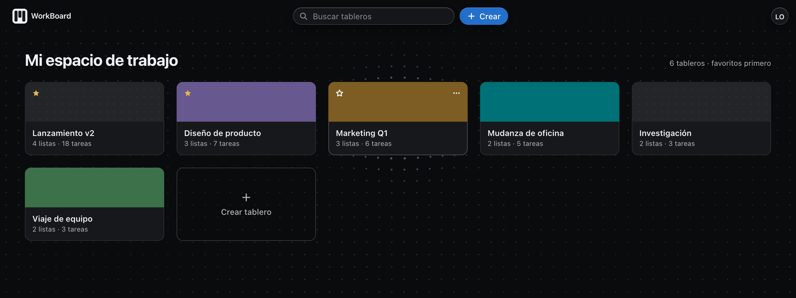

<div align="center">
  <picture>
    <source media="(prefers-color-scheme: dark)" srcset="brand/logo/workboard-simbolo-oscuro.svg" />
    
  </picture>
  <h1>WorkBoard</h1>
  <p>
    <a href="https://getworkboard.netlify.app"><b>Web</b></a>
    &nbsp;·&nbsp;
    <a href="https://getworkboard.netlify.app/descargas/WorkBoard.dmg"><b>Descargar para Mac</b></a>
  </p>
  <p>Organiza cada proyecto en <b>tableros</b>, <b>listas</b> y <b>tareas</b>.<br />Una app nativa para Mac que también funciona en el navegador, con la misma cuenta.</p>
</div>

<p align="center">
  
</p>

## Características

- **Tableros**: con descripción opcional y un fondo de color o una cuadrícula de puntos animada que reacciona al cursor. Marca con ⭐ los que más usas para que aparezcan primero, y búscalos por nombre aunque no escribas las tildes.
- **Listas y tareas**: listas blancas o negras, ordenadas en horizontal; tareas con nombre, descripción y uno de los diez colores.
- **Arrastrar y soltar**: lleva tareas de una lista a otra y reordena las listas. En la web también con el teclado.
- **Deshacer y rehacer** (⌘Z / ⇧⌘Z) cualquier cambio, incluidos los borrados: un tablero vuelve con todas sus listas y tareas.
- **Borrado seguro**: cualquier eliminación definitiva pide confirmación antes.
- **Cuentas**: entra con tu correo o tu nickname y la sesión se mantiene abierta. Las últimas cuentas del dispositivo se abren sin volver a escribir la contraseña. Puedes recuperar la contraseña por correo y eliminar la cuenta con todos sus datos.
- **Mac y web sincronizados**: tus tableros se guardan en la nube y se abren desde cualquiera de las dos.
- **Próximamente**: Notas y Planificador, como paneles laterales dentro de cada tablero.

<table>
  <tr>
    <td width="50%"></td>
    <td width="50%"></td>
  </tr>
  <tr>
    <td align="center">Mi espacio de trabajo, con los favoritos primero</td>
    <td align="center">Listas blancas o negras y tareas de colores</td>
  </tr>
  <tr>
    <td width="50%"></td>
    <td width="50%"></td>
  </tr>
  <tr>
    <td align="center">Arrastrar y soltar tareas y listas</td>
    <td align="center">La web, con las cuentas recientes</td>
  </tr>
</table>

## Plataformas

| Plataforma | Estado | Requisitos |
| --- | --- | --- |
| macOS | ✅ Disponible: [descargar](https://getworkboard.netlify.app/descargas/WorkBoard.dmg) | macOS 27.2 o posterior, Mac con Apple Silicon |
| Web | ✅ Disponible: [getworkboard.netlify.app](https://getworkboard.netlify.app) | Un navegador actual |

### Instalar en el Mac

1. Descarga [WorkBoard.dmg](https://getworkboard.netlify.app/descargas/WorkBoard.dmg), ábrelo y arrastra WorkBoard a **Aplicaciones**.
2. La app no está notarizada por Apple, así que la primera vez macOS no la abrirá. Ve a **Ajustes del Sistema → Privacidad y seguridad**, baja hasta el aviso de WorkBoard y pulsa **Abrir igualmente**.

## Stack tecnológico

| Capa | Tecnología |
| --- | --- |
| App macOS | Swift · SwiftUI · Liquid Glass · supabase-swift · Swift Testing |
| Web | Next.js 16 (App Router) · React 19 · TypeScript · CSS Modules con los tokens del sistema de diseño · `@supabase/ssr` · dnd-kit |
| Tests web | Vitest (lógica) · Playwright y axe (flujos y accesibilidad) |
| Backend | Supabase: PostgreSQL, Auth, Row Level Security y Edge Functions |
| Despliegue | Netlify (web y descarga de la app de Mac) |

## Arquitectura

Monorepo con un único backend compartido por las dos apps:

```
workboard/
├── apps/
│   ├── macOS/      # App nativa (Xcode · SwiftUI) y script del .dmg
│   └── web/        # App web y landing (Next.js)
├── brand/logo/     # Logo en SVG, todas sus variantes y reglas de uso
└── supabase/       # Esquema de la base de datos, migraciones y Edge Functions
```

Las dos apps aplican las mismas reglas (registro, orden de los tableros, posiciones de listas y tareas, deshacer) y hablan con las mismas tablas, protegidas con Row Level Security: cada cuenta solo ve sus datos.
